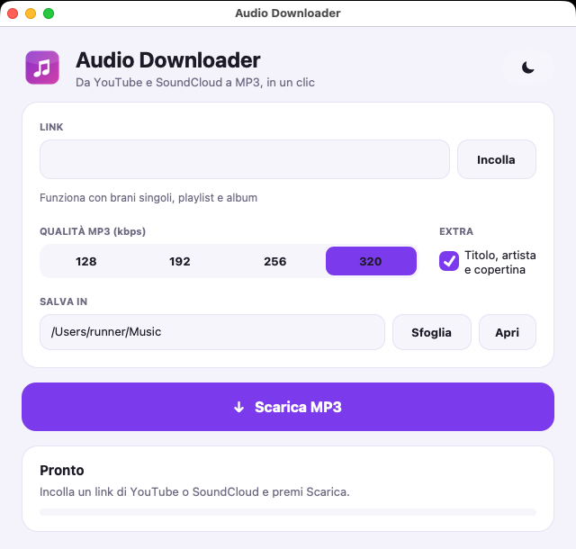

# Audio Downloader per Mac

Scarica l'audio di **YouTube** e **SoundCloud** in **MP3** (fino a 320 kbps), con titolo, artista e copertina già inseriti.
Funziona con brani singoli, playlist e album. Tema chiaro e scuro.



## Installazione (consigliata, un minuto di lavoro)

1. Apri il **Terminale**: premi `⌘ + spazio`, scrivi `Terminale` e premi Invio.
2. Copia questa riga, incollala nel Terminale e premi Invio:

   ```bash
   curl -fsSL https://raw.githubusercontent.com/madashi14/audio-downloader-mac/main/installer/installa.sh | bash
   ```

3. Aspetta qualche minuto. Alla fine l'app si apre da sola e la trovi in **Applicazioni** (o con Spotlight scrivendo "Audio").

Non serve la password e non viene toccato nient'altro sul Mac: Python, ffmpeg e il resto finiscono nella cartella
`~/Library/Application Support/AudioDownloader` (circa 700 MB).

## Installazione con doppio clic (alternativa)

1. Scarica **Audio-Downloader-Mac.zip** dalla pagina [Releases](https://github.com/madashi14/audio-downloader-mac/releases/latest) e aprilo.
2. Fai doppio clic su **Installa Audio Downloader.command**.
3. Se macOS dice che non può verificare lo sviluppatore: apri **Impostazioni di Sistema → Privacy e sicurezza**,
   scorri in fondo e premi **Apri comunque**, poi rifai doppio clic.
   Succede solo perché il file non è firmato con un account Apple Developer (a pagamento): il metodo con il Terminale qui sopra evita questo passaggio.

## Aggiornare

Rifai l'installazione: sostituisce l'app con l'ultima versione e mantiene impostazioni e cronologia.

## Disinstallare

Incolla nel Terminale:

```bash
bash ~/Library/Application\ Support/AudioDownloader/disinstalla.sh
```

oppure fai doppio clic su **Disinstalla Audio Downloader.command** nella cartella dello zip. Gli MP3 scaricati restano dove sono.

## Requisiti

- Mac con Apple Silicon (M1, M2, M3, M4…) o Intel: entrambi testati automaticamente a ogni modifica
  (macOS 26 su Apple Silicon, macOS 15 su Intel; dovrebbe funzionare da macOS 11 in poi)
- Connessione a internet e circa 700 MB di spazio libero

## Problemi comuni

- **"YouTube chiede di dimostrare che non sei un robot"**: YouTube a volte blocca i download da VPN,
  reti aziendali o condivise. Spegni la VPN o riprova più tardi; SoundCloud non ha questo problema.
- **Il Mac non apre "Installa Audio Downloader.command"**: vedi il punto 3 dell'installazione con doppio clic,
  oppure usa il metodo con il Terminale.
- **Qualcosa non va dopo un aggiornamento di macOS**: rifai l'installazione, sistema tutto e mantiene la cronologia.

## Uso responsabile

Scarica solo contenuti che hai il diritto di scaricare (per esempio i tuoi, o con licenza che lo permette).

---

### Per chi sviluppa

| Cartella | Cosa c'è |
|---|---|
| `app/` | l'app: `gui.py` (interfaccia, customtkinter), `downloader.py` (yt-dlp + ffmpeg), `piattaforma.py` (differenze Mac/Windows) |
| `installer/` | `installa.sh` (micromamba + conda-forge: Python, Tk, ffmpeg; pip: yt-dlp, Deno, customtkinter), `crea_app_mac.py` (crea il bundle `.app`), `disinstalla.sh` |
| `tests/` | `test_download.py` (download veri controllati con ffprobe), `test_gui.py` (pilota l'interfaccia e fa screenshot) |
| `.github/workflows/test-mac.yml` | a ogni push installa tutto su un Mac virtuale di GitHub, esegue i test, salva gli screenshot e prepara lo zip |
